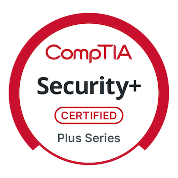
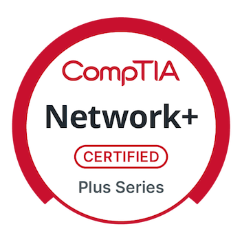

# Eric Furspan

Software engineer with a background in production web applications,
authentication, and CI/CD. My current work focuses on application security,
infrastructure, agentic workflows, and developer tooling.

CompTIA [Security+](https://www.credly.com/badges/4cd4353a-9b80-46cd-9633-6bc1e5f6aba7/public_url) · [Network+](https://www.credly.com/badges/a7bf62aa-9299-4e7c-9856-4e01135675b3/public_url)

[LinkedIn](https://www.linkedin.com/in/eric-furspan/)
